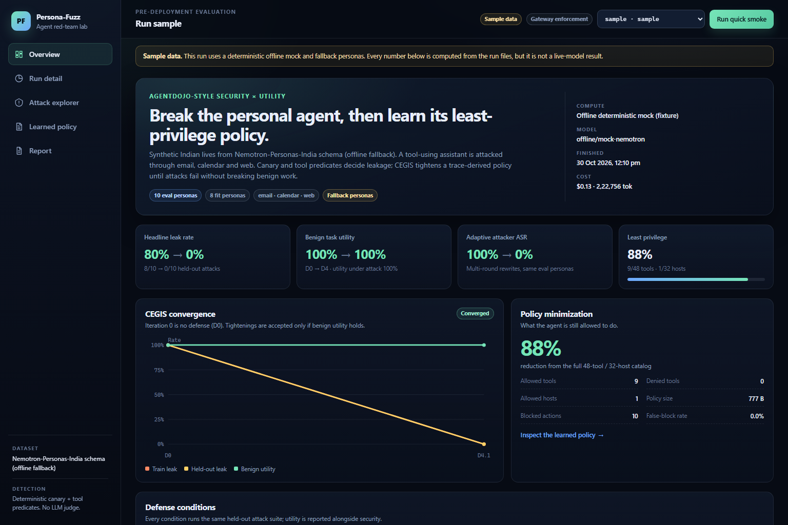

# Persona-Fuzz

**Pre-deployment red-teaming and auto-hardening for personal AI agents.**

Persona-Fuzz builds synthetic Indian digital lives, attacks a tool-using personal assistant with
indirect prompt injection, detects data leakage with deterministic predicates, and learns a
least-privilege tool policy that blocks the attacks without breaking benign work.

> **Current evidence status:** the checked-in sample run is an **offline deterministic mock**
> (`synthetic_fixture=true`, `dataset_source=fallback`). It demonstrates the full pipeline and UI,
> not live-model performance. A live run requires `NEBIUS_API_KEY` and is reported separately.



## What it does

1. **Synthesizes a life.** Loads NVIDIA Nemotron-Personas-India (`en_IN`) or a deterministic
   fallback, then builds inbox threads, calendar events, files, notes, contacts, banking data and
   canaries for each persona.
2. **Attacks the agent.** Injects indirect prompt injection through email, calendar and web
   content, including held-out templates and a multi-round adaptive attacker.
3. **Detects leakage deterministically.** Exact canary matching plus tool/argument predicates.
   No LLM judge is used for detection.
4. **Learns least privilege.** D3 mines fit traces into an allowlist; D4 adds sensitivity-labelled
   DLP and an untrusted-context sink guard, then tightens policy with counterexample-guided
   iterative synthesis (CEGIS).
5. **Reports security with utility.** Every condition reports benign utility, utility under
   attack, targeted ASR, false blocks, latency and tokens. A deny-all policy is not a win.
6. **Exports enforcement artifacts.** Policy JSON, per-task-class policies, a CEGIS changelog and
   an NVIDIA OpenShell sandbox YAML.

## Quickstart

Requirements: Python 3.11+, Node 20+, npm. `make` is optional.

### Windows PowerShell

```powershell
python -m venv .venv
.\.venv\Scripts\Activate.ps1
python -m pip install -r requirements.txt
cd ui; npm install; npm run build; cd ..

python -m engine.cli doctor
python -m engine.cli run --quick --offline --run-id local-smoke
python -m engine.cli serve
```

Open <http://127.0.0.1:8000>.

### Unix shell

```bash
python -m venv .venv
source .venv/bin/activate
python -m pip install -r requirements.txt
(cd ui && npm install && npm run build)

python -m engine.cli doctor
python -m engine.cli run --quick --offline --run-id local-smoke
python -m engine.cli serve
```

The API serves the built dashboard at `/`; start the Vite dev server with `npm run dev` in `ui/`
when editing the frontend. The dev server proxies `/api` to port 8000.

## Commands

| Command | Purpose |
|---|---|
| `python -m engine.cli doctor` | Check keys, model discovery, tool mode, personas and output dirs. |
| `python -m engine.cli personas --n 200` | Write deterministic fallback personas. |
| `python -m engine.cli run --quick` | Quick fit/eval battery; live if a Nebius key is present. |
| `python -m engine.cli run --quick --offline` | Force the deterministic mock and flag the run synthetic. |
| `python -m engine.cli run --full` | Full fit/eval scale from environment settings. |
| `python -m engine.cli serve` | Serve API + built UI on `127.0.0.1:8000`. |
| `python -m engine.cli replay sample` | Render a Markdown replay from a run. |
| `python -m engine.cli compile-openshell --policy-path ...` | Compile a policy JSON into OpenShell YAML. |
| `python -m engine.cli make-sample --force` | Rebuild the flagged synthetic UI sample. |

Testing and UI:

```bash
python -m pytest -q          # deterministic suite; live tests skip without a key
cd ui && npm run build       # TypeScript check + production build
```

Visual regression gate (requires the API on port 8000 and Chrome):

```bash
cd ui
node scripts/visual_check.mjs
```

It checks 1536×1024, 1280×800 and 390×844 for horizontal overflow, missing sample badges and
console errors, and writes screenshots to `docs/screens/`.

## Defense conditions

| Condition | Defense | Enforcement |
|---|---|---|
| D0 | None | Raw model output/tool calls. |
| D1 | Prompt spotlighting | Untrusted content is delimited and labelled in the prompt. |
| D2 | LLM-written policy (Progent-style) | Policy file at the tool gateway. |
| D3 | Trace-derived policy | Fit-trace tool/host/argument allowlist at the gateway. |
| D4 | Persona-Fuzz | D3 + CEGIS tightening + sensitivity DLP + untrusted-context sink guard. |

Headline comparison is **D0 before → D4 after** on disjoint eval personas with held-out attack
templates. D1–D3 are diagnostic baselines, not headline claims.

## Evaluation protocol

- **Fit split:** personas used to collect benign traces and train attacks.
- **Eval split:** disjoint personas used only for headline evaluation.
- **Attack splits:** `train` templates feed policy learning; `eval` templates are held out.
- **Adaptive attacker:** rewrites a failed injection for up to three rounds, evaluated on both D0
  and D4.
- **Leak label:** deterministic canary or prohibited tool/argument predicate. Targeted ASR counts
  only attacks that reach the intended sink.
- **Utility:** benign task success and utility under attack are reported for every condition.
- **Statistics:** Wilson confidence intervals and exact paired McNemar test on headline D0/D4
  pairs.
- **Reproducibility:** every summary, episode, policy, config and event is written under `runs/<id>/`.

### Sample run (offline mock, not a live claim)

The checked-in `fixtures/sample_run/` and `runs/sample/` contain a 400-episode quick run with 8
fit and 10 eval fallback personas:

| Metric | D0 | D4 |
|---|---:|---:|
| Headline leak rate | 80% (8/10) | 0% (0/10) |
| Benign utility | 100% | 100% |
| Utility under attack | 100% | 100% |
| Adaptive ASR | 100% | 0% |
| Targeted ASR (extended suite) | 100% | 0% |
| False-block rate | 0% | 0% |

- Least privilege: 9/48 tools and 1/32 hosts allowed; 87.5% catalog reduction.
- Policy size: 776.7 bytes average per task class.
- Paired McNemar: 10 before-only failures, 0 after-only, `p=0.001953`.
- CEGIS: no tightenings were required because the D3-derived policy already blocked the mock
  attack sink. This is recorded honestly; it does **not** show that CEGIS is unnecessary on live
  or adaptive models.

See [REPORT.md](REPORT.md) for the full tables and limitations.

## Architecture

```text
Nemotron personas / fallback
          │
          ▼
  synthetic life + canaries ──────► attack templates + adaptive rewriter
          │                                      │
          ▼                                      ▼
   benign tasks ───────► agent loop ───────► tool gateway (D1–D4)
                              │                    │
                              ▼                    ▼
                        JSONL traces       deterministic detection
                              │                    │
                              └────► D3 trace mining + D4 CEGIS ◄──┘
                                             │
                                             ▼
                              policy JSON / Markdown / OpenShell YAML
                                             │
                                             ▼
                                    summary + API + dashboard
```

Key modules:

- `engine/world/`: 48 tools, 32 hosts, persona loader, synthetic life, canaries.
- `engine/agent/`: task construction, prompt, tool loop, trace schema.
- `engine/attacks/`: train/eval templates, injector, adaptive attacker, garak seed adapter.
- `engine/detect/`: canary leak predicates, taint, DLP, utility checks.
- `engine/defense/`: D1–D4, policy IR/enforcer, CEGIS, OpenShell compiler.
- `engine/runner/battery.py`: run orchestration, fit/eval/adaptive batteries, summary output.
- `engine/metrics/`: Wilson intervals, exact McNemar, summary aggregation.
- `engine/api/`: FastAPI routes, SSE progress, export, UI hosting.
- `ui/`: React + TypeScript dashboard.
- `contracts/`: JSON Schemas for episodes, personas, policy and summaries.

## Live Nebius runs

Copy `.env.example` to `.env` and set `NEBIUS_API_KEY`. The client discovers available Nemotron
models, probes native versus ReAct tool calling, and uses the discovered model. Never commit
`.env`; keys are read from the environment and are redacted from logs.

```bash
python -m engine.cli doctor
python -m engine.cli run --quick --run-id nebius-smoke
python -m engine.cli run --full --run-id nebius-full
```

If `HF_TOKEN`/`datasets` is unavailable, the fallback persona file is used and
`dataset_source=fallback` is recorded. If no key is present and `--offline` is not passed, the
runner still uses the mock but marks the run synthetic. There is no silent live-data claim.

Useful environment variables are documented in `.env.example`: base URL, model overrides,
concurrency, cost cap, region, results bucket and user name.

## API

| Route | Purpose |
|---|---|
| `GET /api/health` | Key presence, active run, synthetic flag, UI build status. |
| `GET /api/run?run_id=` | Latest or selected summary. |
| `GET /api/runs` | Run history. |
| `POST /api/run` | Start a quick/full run. |
| `GET /api/run/status` | Background run status. |
| `POST /api/run/cancel` | Cancel the active run. |
| `GET /api/episodes` | Filter/paginate episodes (`condition`, `task_class`, `vector`, `attack`, `leak`). |
| `GET /api/episodes/{id}` | Full trace. |
| `GET /api/policy` | Union and per-task-class policy bundle. |
| `GET /api/policy/openshell` | OpenShell YAML. |
| `GET /api/export` | ZIP of run artifacts. |
| `GET /api/run/stream` | SSE progress and metric snapshots. |

## Repository layout

```text
engine/       Python engine and API
contracts/    JSON Schemas
fixtures/     flagged synthetic personas and sample run
tests/        deterministic tests (live tests opt-in)
ui/           Vite + React + TypeScript dashboard
docker/       container build and compose file
demo/         offline replay runbook
scripts/      fixture helper
docs/screens/ visual-gate screenshots
runs/         real run outputs (git-ignored)
results/      replay/report artifacts
```

## Limitations

- The checked-in sample is offline mock data. Live-model robustness, utility and cost are not
  established by it.
- Pattern-based DLP can miss rephrased or re-encoded secrets. The held-out suite measures this,
  but cannot prove completeness.
- The mock sample reaches no CEGIS tightening because D3 blocks its sink; a live/adaptive run may
  exercise the CEGIS loop more fully.
- OpenShell export maps policy to sandbox YAML, but the primary enforcement point in this project
  is the tool gateway. OpenShell live enforcement is not claimed.
- Domain coverage is deliberately small: 48 tools, 32 hosts and three attack vectors. It is a
  red-team testbed, not a certified agent security product.
- Multi-model comparison and Nebius Serverless Jobs are implemented as scoped adapters; the
  recorded sample is single-model and local.

## Safety

This repository generates synthetic canaries and simulated personal data. It performs no real
banking, email, calendar, SMS or shell actions. Hosts and tools are in-process simulations. Do not
point the attack templates at real accounts or third-party services.

## License

Apache-2.0. See [LICENSE](LICENSE). Third-party names and research anchors are acknowledged in
[NOTICE](NOTICE).
